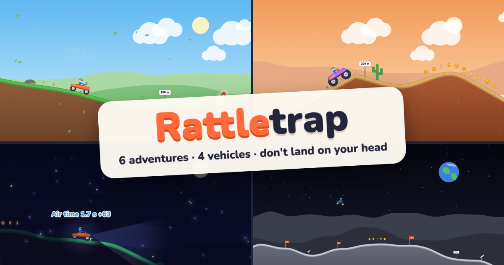

# Rattletrap

**Climb the hills. Don't land on your head.**



A physics driving game that runs in any browser. Drive as far as you can over endless hills.

- Hold **Gas** to drive and **Brake** to slow down or reverse. In the air, Gas tips you back and Brake tips you forward.
- Grab **fuel cans** before the tank runs dry (the top bar says how far the next one is).
- Collect **coins**, smash **crates**, and earn more for **flips**, long **jumps** and **wheelies**.
- If the driver's head touches the ground, or you fall off a bridge, the run is over. Stuck? End the run and keep your coins.

**Six adventures**, each with its own road, physics and look:

| Adventure | What's special |
|---|---|
| Countryside | gentle hills, smashable crates |
| Canyon | wobbly rope bridges over a river, coins ×2 |
| Arctic | icy and slippery, snow falling, coins ×2 |
| Midnight Woods | pitch dark: headlights, lamps, glowing mushrooms and fireflies, coins ×3 |
| Volcano | steep black rock, bridges over lava, coins ×3 |
| The Moon | low gravity: huge jumps, endless flips, coins ×4 |

**Four vehicles**, each with its own handling and its own garage upgrades (engine, suspension,
tyres, fuel tank, 10 levels each) and paint jobs: the Rattletrap truck, a Dirt Bike, a Tractor
and a Monster Truck.

Also: missions (three at a time, harder and better paid each round), bronze/silver/gold medals
for each adventure, a daily gift, stats, music, and settings for sound, engine sound, music,
vibration, the fuel hint, swapped pedals and lighter effects.

Each road is the same on every run, so you learn it, and a flag marks your best distance.

Controls: the on-screen pedals (touch or mouse), or the arrow keys / WASD. P or Esc pauses.

## Run it

Serve the folder (`python3 -m http.server`) and open it in a browser.

## How the code is laid out

- `index.html`: the screens (menu, garage, pause, result) and the pedals.
- `style.css`: how they look, on phones and computers.
- `game.js`: everything else, in 11 commented parts: settings; the adventures, vehicles, upgrades and missions; saving; the road; the physics world; driving; drawing the world; drawing the vehicles; screens; sound and music; start.
- `vendor/planck.min.js`: [planck.js](https://piqnt.com/planck.js/) 1.4.2, a JavaScript copy of the Box2D physics engine (MIT). It handles the wheels, springs and gravity.

`tools/check.js` sends a robot driver through every adventure and vehicle in headless Chrome. It
reports how far each one gets and, when the fuel runs out, how far the next can was, so the hills,
fuel and prices stay balanced:

```
cd tools && npm install && node check.js
```

## Game portals

`node tools/build.js <portal>` packs the game for a game site, with its SDK and an adapter from
`portal/` (ads only between runs, never while driving; with an ad blocker the game just carries on):

```
node tools/build.js itch
node tools/build.js gamedistribution GAME_ID=...
node tools/build.js gamemonetize GAME_ID=...
node tools/build.js y8 APP_ID=... GAME_ID=...
node tools/build.js playgama
```

Each portal gives you its IDs once you add the game in its developer dashboard. The Playgama build
saves through Playgama Bridge and turns off the engine sound (Playgama only allows recorded sounds).

## Android app

`android-app/` packs the game as an Android app with Capacitor, with fair AdMob ads (an optional
"double your coins" ad, and a short ad at most every few runs, never while driving). See
[android-app/README.md](android-app/README.md) for building it, AdMob, signing and Google Play.
Privacy policy: [privacy.html](https://annapurnageeks.github.io/rattletrap/privacy.html).

## Credits

Physics: planck.js (MIT, `vendor/planck-LICENSE.txt`).
Sounds: [Interface Sounds](https://kenney.nl/assets/interface-sounds) by Kenney (CC0). The engine sound is made in code.
Music: "Exploration Theme" by Cleyton Kauffman ([OpenGameArt](https://opengameart.org/content/exploration-theme), CC0).
Font: [Nunito](https://fonts.google.com/specimen/Nunito) (SIL Open Font License, `fonts/OFL.txt`).
Code and art: MIT.
